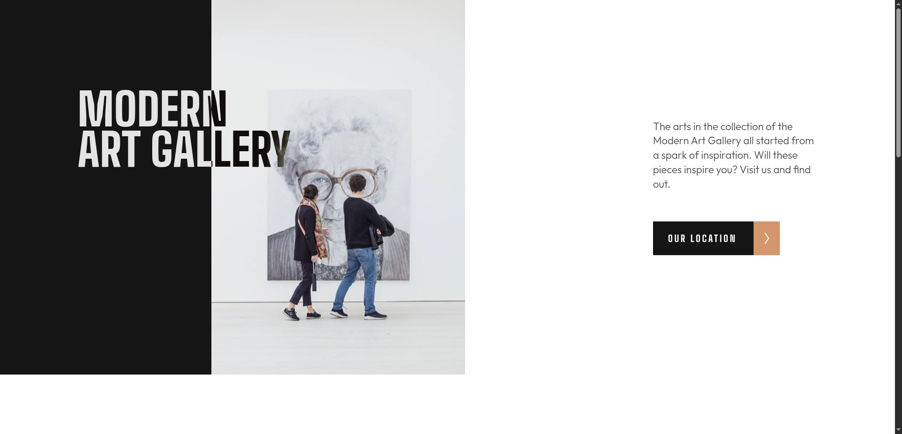
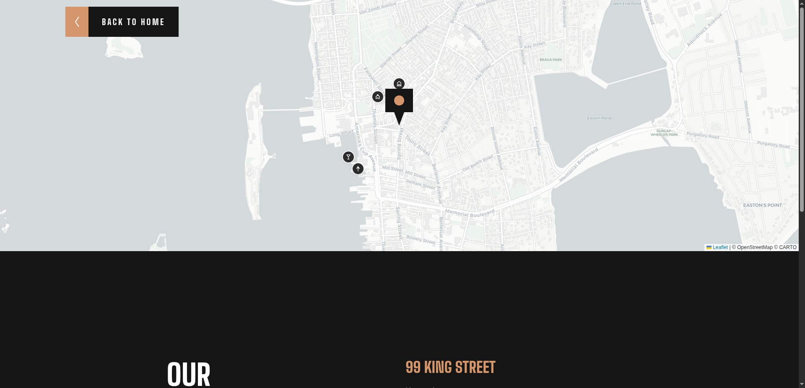

# Frontend Mentor - Art Gallery Website Solution

This is my solution to the [Art Gallery website challenge on Frontend Mentor](https://www.frontendmentor.io/challenges/art-gallery-website-yVdrZlxyA). The project is a responsive landing page for a modern art gallery, with a separate location page featuring an interactive map.

## Table of contents

- [Frontend Mentor - Art Gallery Website Solution](#frontend-mentor---art-gallery-website-solution)
  - [Table of contents](#table-of-contents)
  - [Overview](#overview)
    - [The challenge](#the-challenge)
    - [Screenshots](#screenshots)
    - [Links](#links)
  - [My process](#my-process)
    - [Built with](#built-with)
    - [Features](#features)
    - [What I learned](#what-i-learned)
    - [Continued development](#continued-development)
    - [Useful resources](#useful-resources)
    - [AI collaboration](#ai-collaboration)
  - [Author](#author)
  - [Acknowledgments](#acknowledgments)

## Overview

### The challenge

The goal was to build a responsive art gallery website that adapts to mobile, tablet, and desktop screen sizes. The site should include interactive hover states and, as a bonus, an interactive map with a custom location marker.

### Screenshots

Add screenshots of the homepage and location page here when they are ready:

- Homepage: 
- Location page: 

### Links

- Solution URL: [GitHub repository](https://github.com/runny-life/art-gallery)
- Live Site URL: [Github pages](https://runny-life.github.io/art-gallery/)

## My process

### Built with

- Semantic HTML5
- SCSS (Sass)
- CSS custom properties
- CSS Grid and Flexbox
- Responsive, mobile-first layouts
- Responsive images with `<picture>` and `srcset`
- JavaScript modules
- [Vite](https://vite.dev/) for development and production builds
- [Leaflet](https://leafletjs.com/) for the interactive map
- [CARTO](https://carto.com/) map tiles and [OpenStreetMap](https://www.openstreetmap.org/) attribution

### Features

- Responsive homepage and location page.
- Gallery layout that adapts to different viewport widths.
- Responsive image assets for mobile, tablet, and desktop, including high-density variants.
- Reusable SCSS styles, variables, mixins, and helper functions.
- Navigation between the homepage and location page.
- Interactive Leaflet map centered on Newport, Rhode Island.
- Custom-styled main map marker and additional points of interest.
- Popups for map markers and tooltips for nearby locations.
- Hover states and transitions for interactive elements.
- Social links in the footer.

### What I learned

While building this project, I practised structuring a multi-page site with semantic HTML and organising styles into smaller SCSS modules.

Some of the main topics I worked with:

- **Responsive images:** using `<picture>`, media conditions, and `srcset` to serve appropriate image sizes for different screens.
- **Responsive layouts:** combining Grid and Flexbox with breakpoints to adapt the gallery sections to mobile, tablet, and desktop.
- **SCSS organisation:** splitting styles into base styles, components, layout sections, variables, mixins, and helper functions.
- **JavaScript modules:** importing the map library and stylesheet into the application entry point.
- **Leaflet custom markers:** creating markers with `L.divIcon()`, inline SVG, custom anchor points, popups, and tooltips.
- **Multi-page navigation:** linking the homepage to a separate location page.

Example of creating a custom Leaflet marker:

```js
const poiIcon = (svgPath) =>
  L.divIcon({
    className: 'poi-marker',
    html: `
      <div class="poi-marker__bubble">
        <svg viewBox="0 0 24 24" fill="none" stroke="white"
             stroke-width="2.2" stroke-linecap="round"
             stroke-linejoin="round">
          ${svgPath}
        </svg>
      </div>
    `,
    iconSize: [26, 26],
    iconAnchor: [13, 13],
  });
```

This approach makes it possible to reuse one marker factory while passing a different SVG icon for each point of interest.

### Continued development

In future projects, I want to keep improving:

- Accessibility, including keyboard focus styles and clear focus indicators for links and controls.
- Responsive behaviour across a wider range of screen sizes.
- SCSS architecture and the maintainability of reusable styles.
- JavaScript fundamentals and writing smaller, easier-to-test functions.
- Performance and production checks, including image optimisation and testing the final build.
- Cross-browser testing and checking the site with keyboard navigation.

### Useful resources

- [Frontend Mentor](https://www.frontendmentor.io/) — the challenge brief and design files.
- [MDN Web Docs](https://developer.mozilla.org/) — reference for HTML, CSS, JavaScript, and responsive images.
- [Sass documentation](https://sass-lang.com/documentation/) — SCSS syntax and stylesheet organisation.
- [Vite documentation](https://vite.dev/guide/) — development server and production builds.
- [Leaflet documentation](https://leafletjs.com/reference.html) — map setup, markers, popups, and tooltips.
- [OpenStreetMap](https://www.openstreetmap.org/) — map data and project information.

### AI collaboration

ChatGPT was used to help prepare and structure this README. The project details above are based on the files and implementation in this repository.

## Author

- Website: [GitHub](https://github.com/runny-life)
- Frontend Mentor: [runny-life](https://www.frontendmentor.io/profile/runny-life)

## Acknowledgments

Thanks to Frontend Mentor for providing the challenge and design resources, and to the maintainers of Vite, Sass, and Leaflet for their documentation and tools.
